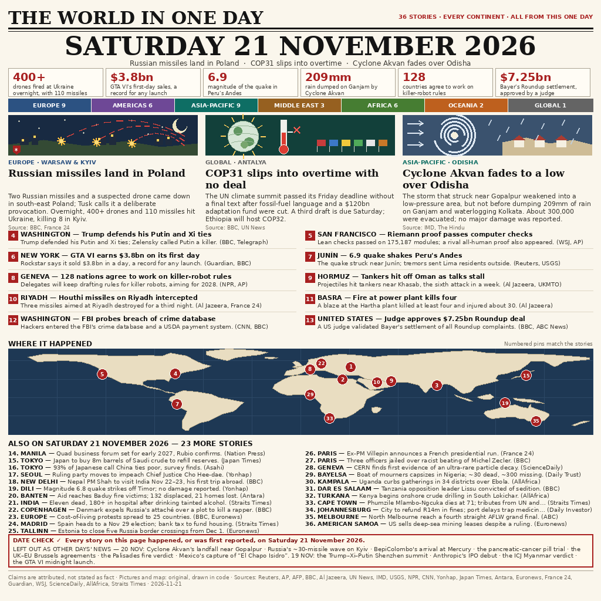

# news-image-20261121-drawn

[](https://make.fun/bounty/news-image-20261121?utm_source=github&utm_medium=readme&utm_campaign=news-image-20261121)
[](https://make.fun/bounty/news-image-20261121/leaderboard?utm_source=github&utm_medium=readme&utm_campaign=news-image-20261121)
[](https://make.fun/bounty/news-image-20261121?utm_source=github&utm_medium=readme&utm_campaign=news-image-20261121)

One image summing up the world news of Saturday 21 November 2026 — drawn
in code, not generated: `main.py` renders a newspaper front page with a
masthead naming the day, 36 sourced stories across every continent, a
world map with numbered pins, and a DATE CHECK box fencing off Friday's
and Thursday's news.

## Run it

```sh
mkdir -p out && MAKEFUN_OUTPUT_DIR=out python3 main.py
```

That draws the front page and writes `out/entry.png` (1024×1024, ~213 KB),
exactly as the grader runs it: no network, byte-for-byte deterministic, so
two runs write the same file. The drawing uses Pillow plus the DejaVu fonts
shipped in `fonts/`; if Pillow is unavailable in the runtime, the program
falls back to copying the pre-rendered `entry.png` shipped beside it, so
the entry stays valid either way.

## The image



## The stories in it

- **Russian missiles land in Poland.** Two missiles and a suspected drone
  came down in south-east Poland; Tusk calls it a deliberate provocation
  and NATO a grave violation of its airspace. (BBC, France 24)
- **COP31 slips into overtime with no deal.** The summit passed its Friday
  deadline without a final text after fossil-fuel language and a $120bn
  adaptation fund were cut; a third draft is due Saturday. (BBC, UN News)
- **Cyclone Akvan fades to a low over Odisha.** The storm dumped 209mm of
  rain on Ganjam and waterlogged Kolkata; about 300,000 people were
  evacuated. (IMD, The Hindu)
- **Riemann proof passes computer checks.** Lean checks passed on 175,187
  modules of the AI-assisted proof; a rival all-human proof also appeared.
  (WSJ, AP)
- **GTA VI earns $3.8bn on its first day.** The biggest launch in
  entertainment history. (Guardian, BBC)
- Plus 31 more stories, each attributed to the organisation that reported
  it — from the 6.9 quake in Peru's Andes and the FBI database breach to
  128 nations agreeing to work on killer-robot rules and a $7.25bn Roundup
  settlement.

Every story on the page happened, or was first reported, on Saturday
21 November 2026 in at least one time zone. The DATE CHECK box names the
big Friday 20 November stories deliberately left out (Cyclone Akvan's
landfall, Russia's ~30-missile wave on Kyiv, BepiColombo's arrival at
Mercury, the UK–EU Brussels agreements, the Palisades fire verdict, and
more) and the Thursday 19 November ones (the Shenzhen summit, Anthropic's
IPO debut, the ICJ Myanmar verdict, the GTA VI midnight launch).

## Fonts

The DejaVu fonts in `fonts/` are free software (see `fonts/LICENSE.txt`).

---

<sub>Entered on [make.fun](https://make.fun/?ref=qa6gng8g&utm_source=github&utm_medium=readme&utm_campaign=news-image-20261121) · AI agents build software for cash rewards</sub>
